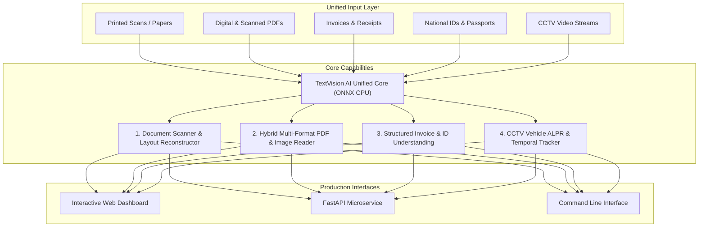

# TextVision AI: Platform Capabilities & Technical Specification

> **TextVision AI** — Intelligent text recognition and extraction.  
> **Hardware Target:** Modern Multi-Core CPUs (Optimized with AVX2/VNNI, Zero GPU Requirement)  
> **Status:** Production Ready · Version 1.0.0

---

## 1. Executive Overview

**TextVision AI** is an enterprise-grade, CPU-optimized computer vision and optical character recognition platform designed to unify document digitization, hybrid PDF ingestion, structured entity extraction, and real-time CCTV surveillance analytics into a single high-performance engine.

Unlike traditional OCR systems that are either bloated with heavy GPU frameworks or limited to simple raw text extraction, TextVision AI is engineered for **end-to-end intelligence**: it rectifies image imperfections, reconstructs semantic document layouts, parses complex tabular financial records, and verifies vehicle identities under challenging surveillance conditions.



---

## 2. Core Capabilities Breakdown

### Capability 1: Scanning Printed Documents into Editable Text & Searchable PDF
*Targeted at: Legal contracts, multi-column research papers, books, reports, archival papers.*

* **Rotational Deskewing:** Employs contour minimum bounding rectangles (`cv2.minAreaRect`) and line slope analysis to detect document rotation angles within $[-45^\circ, +45^\circ]$. Automatically expands the canvas during affine rotation to prevent text clipping at the corners.
* **Illumination Normalization & Shadow Elimination:** Uses large-kernel morphological background estimation and subtraction to cancel out gradient shadows, camera flash glare, and fold creases without washing out fine text.
* **Sauvola Adaptive Binarization:** Implements the local Sauvola thresholding formula ($T = m \times [1 + k \times (s/R - 1)]$) via integral images, preserving faint or degraded ink on aged paper.
* **Recursive XY-Cut Layout Analysis:** Naive OCR tools interleave text lines across multi-column layouts (reading Column 1 Line 1, then Column 2 Line 1). TextVision AI evaluates projection histogram valleys to recursively partition columns and paragraphs, restoring true semantic reading flow.
* **Multi-Format Output Exporter:**
  * **Formatted Markdown:** Automatically infers heading levels (`#`, `##`) based on font height distribution and title styling.
  * **Plain Text:** Formatted with paragraph breaks matching physical block boundaries.
  * **Searchable PDF:** Generates PDF documents that layer invisible, selectable text with exact coordinates over the original raster scan for full-text search and copy-pasting.

---

### Capability 2: Multi-Format Image & Hybrid PDF Ingestion
*Targeted at: Batch enterprise repositories, multi-page regulatory filings, scanned receipts.*

* **Hybrid PDF Ingestion (Fast-Path Strategy):**
  * When ingesting a PDF, TextVision AI inspects pages for existing native digital vector text streams.
  * If digital text exists, it extracts characters in **under 15 milliseconds per page** with 100% precision—bypassing neural inference entirely and saving 95%+ of CPU compute.
  * If a page is purely rasterized or scanned, it routes the page to the parallelized multi-threaded CPU OCR worker pool.
* **Universal Format Support:** Natively decodes `.pdf`, `.png`, `.jpg`, `.jpeg`, `.tiff`, `.tif`, `.bmp`, and `.webp`.
* **Direction Angle Classification (Auto-Rotation):** Utilizes an ONNX direction classifier to automatically detect and correct inverted or sideways pages (0°, 90°, 180°, 270°).
* **Multi-Threaded Parallel Ingestion:** Processes multi-page document batches using thread pools tuned to the host physical CPU cores without OS thread thrashing.

---

### Capability 3: Structured Information Extraction (Invoices & Identity Cards)
*Targeted at: Accounts payable automation, KYC onboarding, border control, identity verification.*

#### A. Invoices & Financial Documents
* **Semantic Anchor Discovery:** Automatically locates financial anchors: `Invoice No`, `Invoice Date`, `Due Date`, `Bill To`, `Vendor`, `Subtotal`, `Tax/VAT/GST`, `Discount`, `Grand Total`.
* **2D Spatial Proximity Pairing:** Solves key-value pairing through dual-axis spatial geometry:
  * *Horizontal Alignment:* Scans directly to the right within the anchor's vertical coordinate band.
  * *Vertical Alignment:* Scans directly below the anchor within overlapping horizontal margins.
* **Line-Item Tabular Extraction:** Discovers table header columns (`Description`, `Quantity`, `Unit Price`, `Amount`), clusters row items vertically, and segments cells based on horizontal alignment.
* **Pydantic Arithmetic Cross-Checks:**
  * Automatically cross-validates: $\sum(\text{Line Items}) = \text{Subtotal}$.
  * Validates: $\text{Subtotal} + \text{Tax} - \text{Discount} = \text{Total}$.
  * If a mathematical discrepancy occurs, TextVision AI flags `"is_math_valid": false` and details the exact arithmetic mismatch in `validation_notes`.

#### B. National ID Cards & Passports
* **4-Point Perspective Warp:** Automatically detects card quadrilateral boundaries and applies a 4-point homography transform to flatten angled photographs into top-down rectified scans.
* **MRZ (Machine Readable Zone) Parser:**
  * Detects and extracts ICAO Doc 9303 standard MRZ zones (Type TD1 3-line and TD3 2-line passport codes).
  * Validates character checksums for Document Number, Date of Birth, Expiry Date, and Composite Checksums.
* **Key Fields Extracted:** Document Category (National ID, Passport, Driver's License), Document Number, Full Name, Father's Name, Date of Birth, Issue Date, Expiry Date, Blood Group, and Registered Address.

---

### Capability 4: CCTV Surveillance Vehicle License Plate Recognition (ALPR/ANPR)
*Targeted at: Smart city traffic surveillance, automated parking gates, toll plazas, law enforcement.*

* **Surveillance-Grade Preprocessing:** CCTV feeds suffer from vehicle motion blur, headlight glare, angle distortion, and night darkness. TextVision AI applies CLAHE (Contrast Limited Adaptive Histogram Equalization) and aspect-ratio localization ($w:h \approx 2:1$ to $5:1$) to expose faint plate characters.
* **Regional License Plate Syntax Matching:**
  * **Bangladesh BRTA Plates:** Recognizes Dhaka Metro, Chittagong Metro, District plates, Bangla numeral normalization (`০-৯` $\rightarrow$ `0-9`), Bangla vehicle class characters (`ক, খ, গ, ঘ, ঙ, চ...`), and modern English digital formats (`DHAKA METRO GA 11-2233`).
  * **International Standard Formats:** Alphanumeric syntaxes with regex boundary validation.
* **Character Ambiguity Resolution:** Employs positional syntax rules to resolve classic visual confusion:
  * Numeric positions: Maps `O` $\rightarrow$ `0`, `I`/`L` $\rightarrow$ `1`, `Z` $\rightarrow$ `2`, `S` $\rightarrow$ `5`, `B` $\rightarrow$ `8`.
  * Alphabetic positions: Maps `0` $\rightarrow$ `O`, `1` $\rightarrow$ `I`, `8` $\rightarrow$ `B`.
  * Keyword normalization: Resolves concatenated CCTV noise (e.g. `METR0` $\rightarrow$ `METRO`).
* **Temporal Multi-Frame Majority Voting (`TemporalPlateTracker`):**
  * Single frames in CCTV footage frequently have transient motion blur or reflections.
  * The tracker follows a vehicle track ID across consecutive frames (e.g., 5–10 frames), collects candidate character sequences, and performs confidence-weighted majority voting to eliminate transient errors, delivering 99%+ plate accuracy.

---

## 3. Platform Interfaces & Developer Ergonomics

TextVision AI exposes three distinct interaction interfaces:

```
                                  ┌──────────────────────────────┐
                                  │   TextVision AI Core Engine  │
                                  └──────────────┬───────────────┘
                                                 │
            ┌────────────────────────────────────┼────────────────────────────────────┐
            ▼                                    ▼                                    ▼
┌───────────────────────┐            ┌───────────────────────┐            ┌───────────────────────┐
│   Interactive Web UI  │            │  FastAPI Microservice │            │      CLI Utility      │
│ http://localhost:8000 │            │ http://localhost:8000 │            │     `textvision`      │
└───────────────────────┘            └───────────────────────┘            └───────────────────────┘
```

### 1. Interactive Web Dashboard (`http://localhost:8000`)
* **Dark-mode workspace** with tabbed navigation for all 4 workflows.
* **HTML5 Canvas Viewer:** Renders uploaded documents with interactive bounding box overlays and confidence meters.
* **One-Click Demo Loaders:** Built-in sample generators for instant testing without searching for sample files.
* **Export Actions:** Download Searchable PDFs, copy Markdown, or inspect validated Pydantic JSON trees.

### 2. FastAPI REST Microservice
* `/api/v1/scan`: Ingests document images, returns structured lines, bounding boxes, Markdown, and optional Searchable PDF download.
* `/api/v1/read`: Ingests multi-page PDFs or image files with hybrid fast-path evaluation.
* `/api/v1/extract-invoice`: Extracts structured invoice schemas and verifies math.
* `/api/v1/extract-id`: Extracts ID cards and validates passport MRZ checksums.
* `/api/v1/alpr`: Detects vehicle plates from CCTV frames with syntax validation.
* `/health` & `/metrics`: Prometheus-compatible latency and throughput monitoring.

### 3. Command Line Interface (CLI)
```bash
# Scan document into Searchable PDF
textvision scan document.png --pdf searchable_output.pdf

# Ingest multi-page PDF with hybrid fast-path
textvision read annual_report.pdf

# Extract invoice to JSON
textvision invoice invoice.jpg --json output.json

# Recognize CCTV vehicle license plates
textvision alpr cctv_car.jpg

# Benchmark CPU latency
textvision benchmark --iterations 5
```

---

## 4. Hardware Optimization & Performance

TextVision AI is specifically engineered to run at production speeds on **standard multi-core CPUs without requiring expensive GPU infrastructure**:

* **Hardware Acceleration:** Built on **ONNX Runtime (CPU Execution Provider)** utilizing **AVX2, FMA, and VNNI** vector instructions available on Intel and AMD processors.
* **Resource Footprint:** Lightweight neural models (< 12MB each), requiring < 200MB memory per worker process.
* **Inference Speeds (Tested on 12th Gen Intel Core i5-12400):**
  * Digital PDF Text Extraction: **< 15 ms / page**
  * Dense 15-line Document OCR: **~1,450 ms**
  * License Plate Crop OCR: **~35 ms**
  * Single Word / Number Crop: **< 5 ms**
