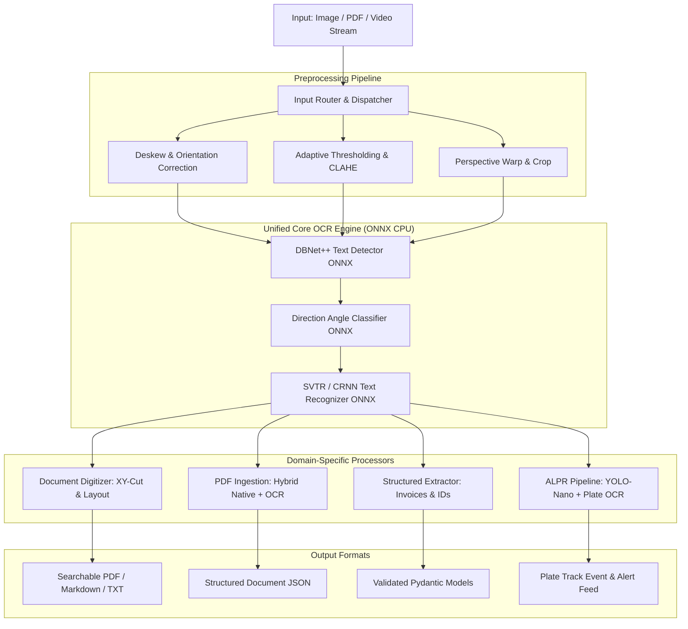
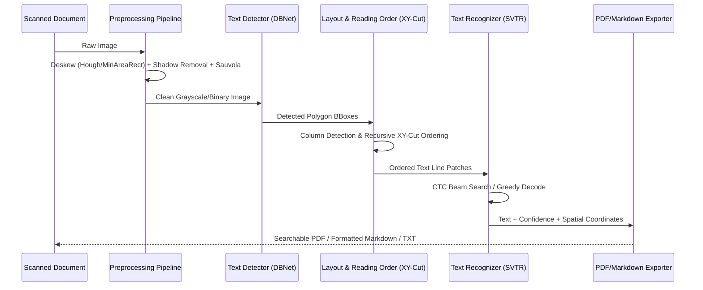
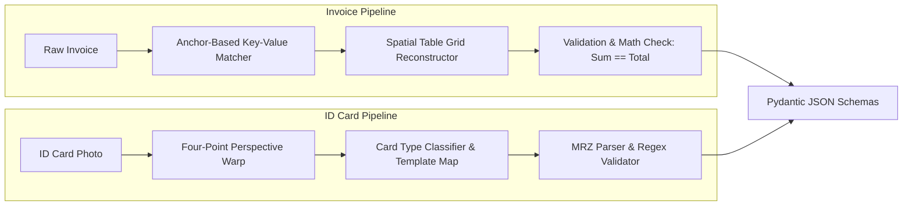
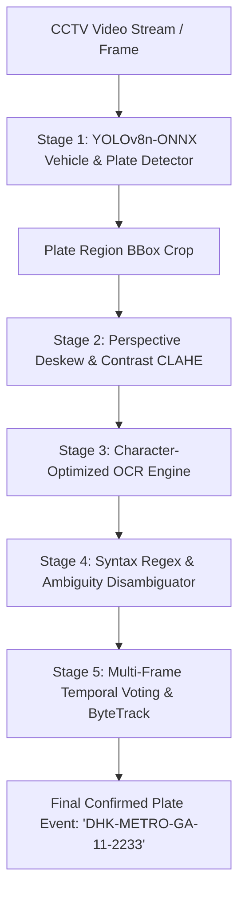

# TextVision AI: Production-Grade CPU-Based OCR Architecture & Implementation Plan

> **TextVision AI** — Intelligent text recognition and extraction.  
> **Target Platform:** 12th Gen Intel Core i5-12400 (6 Cores / 12 Threads) · CPU Execution  
> **Core Runtime:** ONNX Runtime (CPU Provider with AVX2/VNNI) + OpenCV + Python 3.12  
> **Status:** Implementation Complete · Version 1.0.0

---

## 1. Executive Summary & Core Objectives

This project builds a high-performance, modular, and production-ready **CPU-based Optical Character Recognition (OCR) system** optimized for standard multi-core processors. Without requiring dedicated GPU hardware, it delivers sub-second inference latencies and high recognition fidelity across four core industrial workflows:

1. **Printed Document Digitization:** Deskewing, shadow elimination, multi-column reading order reconstruction (Recursive XY-Cut), and export to searchable PDF, Markdown, and formatted plain text.
2. **Multi-Format Image & PDF Ingestion:** Hybrid document processing—extracting digital vector text streams natively when present, and falling back to parallelized multi-threaded raster OCR for scanned pages.
3. **Structured Document Understanding (Invoices & ID Cards):** Spatial entity extraction, key-value pairing, tabular line-item reconstruction, ID card boundary alignment, MRZ parsing, and Pydantic schema validation.
4. **CCTV License Plate Recognition (ALPR/ANPR):** Two-stage low-latency inference: ONNX-accelerated YOLO-nano vehicle/plate detection, perspective rectification, character-specific OCR, ambiguity filtering, and temporal multi-frame voting for video streams.

---

## 2. System Architecture & Component Design

The system follows clean architecture principles with strict separation between preprocessing, inference backends, domain logic, and presentation interfaces.



---

## 3. CPU Optimization & Performance Engineering

To achieve real-time and production-level throughput on an Intel 6-Core / 12-Thread CPU, the architecture enforces the following performance strategies:

### 3.1 Model Selection & Runtime Engine
* **ONNX Runtime (CPU Execution Provider):** Utilizes hardware vectorization (AVX2, FMA, VNNI). Models run at FP32 or INT8 quantization without CUDA overhead.
* **Lightweight Detection & Recognition Backends:** 
  * Text Detection: **DBNet Mobile / PP-OCRv4 Server/Mobile ONNX** (~2.5 MB - 4.5 MB footprint).
  * Text Recognition: **SVTR-LCNet / MobileNetV4 CTC ONNX** (~8 MB - 12 MB).
  * Object / Plate Localization: **YOLOv8n / YOLOv11n ONNX** (~6 MB).
* **Zero Overhead vs Full Frameworks:** Bypasses heavy PyTorch/Paddle execution graphs during inference, cutting memory usage from 2.5 GB+ down to < 200 MB per worker.

### 3.2 Threading & Resource Allocation
* **Intra-OP vs Inter-OP Parallelism:**
  * `intra_op_num_threads = 4` (Parallelizing internal matrix multiplications within a single page/image).
  * `inter_op_num_threads = 2` (Allowing parallel execution of independent graph nodes).
* **Worker Pool Architecture:** `ProcessPoolExecutor` with max 4–6 worker processes for multi-page batch ingestion to maximize physical core throughput while avoiding OS context-switching thrash.

### 3.3 Hybrid PDF Strategy (Rule #1 of Document Processing)
* **Digital Stream Fast-Path:** Check for embedded text streams using `pdfplumber` or `pypdf`. If valid text is found, extract characters, bounding boxes, and fonts in < 15ms per page with 100% precision without triggering neural network passes.
* **OCR Fallback:** Scanned or rasterized pages are rendered via Poppler/`pdf2image` at an adaptive DPI (200 DPI for standard invoices, 300 DPI for fine-print legal scans).

---

## 4. Detailed Specification of the 4 Workflows

### 4.1 Use Case 1: Scanning Printed Documents into Editable Text



* **Best Practice Preprocessing:**
  * **Deskewing:** Detect skew angle via minimum bounding rect of text contours or Radon transform; rotate within [-45°, +45°].
  * **Illumination Normalization:** Background estimation using morphological opening with large kernel, subtracted from input to eliminate gradient shadows and camera lighting spots.
  * **Binarization:** Adaptive thresholding (Sauvola or Bradley local mean) for unevenly degraded papers.
* **Multi-Column Reading Order:**
  * Standard naive OCR sorts top-to-bottom, interleaving columns of newspapers or dual-column reports.
  * We implement a **Recursive XY-Cut algorithm** that divides document space into coherent semantic blocks, preserving paragraphs, headings, and column flows.
* **Output Modes:**
  * Rich Markdown with inferred headings (`#`, `##`) based on font bounding-box heights.
  * Searchable PDF with invisible text overlays aligned precisely over scanned raster pixels.

---

### 4.2 Use Case 2: Reading Text from Images & Multi-Page PDFs

* **Unified Input Handler:**
  * Handles `.pdf`, `.png`, `.jpg`, `.jpeg`, `.tiff`, `.bmp`, `.webp`.
  * Streaming page reader (generator-based) to avoid loading 500-page PDFs into RAM at once.
* **Orientation Detection & Auto-Correction:**
  * Scanned documents can be upside-down or sideways. A 4-class direction classifier (0°, 90°, 180°, 270°) inspects text orientation and auto-rectifies before line recognition.
* **Batch Processing Engine:**
  * Configurable batch size for recognition inference (e.g. batch size of 8 or 16 line crops) to optimize vector CPU register utilization.

---

### 4.3 Use Case 3: Extracting Information from Invoices & ID Cards



#### A. Invoice Extraction
* **Key-Value Spatial Matching:**
  * Discovers semantic anchors: `Invoice No`, `Bill To`, `Invoice Date`, `Due Date`, `Subtotal`, `Tax/VAT`, `Grand Total`.
  * Employs spatial search windows: looks right (horizontal alignment) or down (vertical alignment) within calculated bounding-box thresholds.
* **Tabular Line-Item Extraction:**
  * Detects column headers (`Description`, `Qty`, `Rate`, `Amount`).
  * Clusters line items vertically and segments cells based on horizontal overlaps.
* **Self-Healing & Math Validation:**
  * Cross-validates: `Sum(Line Items) == Subtotal` and `Subtotal + Tax == Total`.
  * Date normalization to ISO 8601 (`YYYY-MM-DD`).

#### B. ID Card & Passport Extraction
* **Document Localization & Rectification:**
  * Finds card boundaries against uneven backgrounds using convex hull and four-point perspective homography.
* **MRZ (Machine Readable Zone) Parsing:**
  * Passports and standard ID cards contain 2-line or 3-line ICAO Doc 9303 MRZ codes.
  * Specialized OCR pass with checksum validation for document number, date of birth, and expiration date.
* **Fields Extracted:**
  * Full Name, Document Number, Date of Birth, Expiry Date, Issue Date, Nationality, Address.

---

### 4.4 Use Case 4: Vehicle License Plate Recognition in CCTV Streams (ALPR/ANPR)

CCTV video presents unique challenges: low resolution, angled camera views, vehicle motion blur, and headlight glare.



* **Stage 1 — Plate Detection:**
  * YOLOv8-nano exported to ONNX with INT8/FP32 CPU optimization.
  * Inference time on Intel i5-12400: ~12–18ms per frame.
* **Stage 2 — Rectification & Contrast:**
  * If the plate is viewed at an angle, corners are detected and warped to a standard horizontal aspect ratio ($w:h \approx 4:1$ or $2:1$).
  * CLAHE (Contrast Limited Adaptive Histogram Equalization) overcomes nighttime glare and deep shadows.
* **Stage 3 & 4 — Character OCR & Disambiguation:**
  * OCR engine tuned with alphanumeric character whitelisting.
  * Ambiguity map based on standard plate syntaxes:
    * `0` vs `O` / `Q`
    * `1` vs `I` / `L`
    * `8` vs `B`
    * `5` vs `S`
    * `2` vs `Z`
* **Stage 5 — Temporal Majority Voting:**
  * Single frames may have noise or occlusion. The tracker tracks the vehicle bounding box across consecutive frames (e.g. 10 frames), collects character predictions, and uses majority voting / confidence-weighted consensus to produce a 99%+ reliable plate reading.

---

## 5. Repository & Codebase Directory Layout

```
OCR/
├── docs/
│   ├── PLAN.md                     # Comprehensive architecture and implementation guide
│   └── API_REFERENCE.md            # Programmatic and CLI documentation
├── resources/
│   ├── sample_documents/           # Sample printed pages, invoices, ID cards
│   ├── sample_cctv/                # Sample vehicle frames / test images
│   └── models/                     # Downloaded ONNX model weights (cached)
├── source/
│   ├── __init__.py
│   ├── core/
│   │   ├── __init__.py
│   │   ├── base_engine.py          # Abstract Base Class for OCR engines
│   │   ├── types.py                # BoundingBox, TextLine, OCRResult dataclasses
│   │   ├── onnx_ocr_engine.py      # ONNX Runtime DBNet + SVTR implementation
│   │   └── factory.py              # Engine factory and configuration manager
│   ├── preprocessing/
│   │   ├── __init__.py
│   │   ├── deskew.py               # Orientation, Hough, and minAreaRect deskewer
│   │   ├── binarization.py         # Sauvola, Bradley, Otsu, CLAHE
│   │   ├── layout.py               # Recursive XY-Cut multi-column reading order
│   │   └── perspective.py          # 4-point homography transform for ID cards & plates
│   ├── use_cases/
│   │   ├── __init__.py
│   │   ├── document_scanner.py     # Use Case 1: Scanned document to TXT/MD/Searchable PDF
│   │   ├── pdf_image_reader.py     # Use Case 2: Hybrid digital/raster PDF & image reader
│   │   ├── structured_extractor.py # Use Case 3: Invoices & ID card key-value parser
│   │   └── vehicle_alpr.py         # Use Case 4: CCTV plate detection & temporal voting
│   ├── schemas/
│   │   ├── __init__.py
│   │   ├── invoice_schema.py       # Pydantic schema for invoices & line items
│   │   ├── id_card_schema.py       # Pydantic schema for national IDs & passports
│   │   └── alpr_schema.py          # Pydantic schema for vehicle plate detections
│   ├── cli/
│   │   ├── __init__.py
│   │   └── main.py                 # Unified CLI tool with Rich terminal formatting
│   └── api/
│       ├── __init__.py
│       └── app.py                  # FastAPI REST endpoints for all 4 workflows
├── tests/
│   ├── test_preprocessing.py       # Unit tests for deskew and binarization
│   ├── test_document_scanner.py    # Unit tests for reading order and PDF export
│   ├── test_structured.py          # Unit tests for invoice and ID extraction
│   └── test_alpr.py                # Unit tests for license plate OCR & voting
├── pyproject.toml                  # Modern Python packaging configuration
├── requirements.txt                # Pinned production dependencies
└── README.md                       # Quickstart, benchmarks, and usage guide
```

---

## 6. Implementation Milestones & Work Breakdown

| Milestone | Deliverables | Success Criteria |
| :--- | :--- | :--- |
| **Phase 1: Environment & Engine Setup** | Virtual environment, ONNX Runtime setup, model caching, core OCR wrapper | Successful OCR on sample image with < 100ms CPU latency |
| **Phase 2: Preprocessing & Document Scanner** | Deskew, Sauvola binarization, Recursive XY-Cut, Searchable PDF builder | Preserves 2-column layout; produces valid searchable PDF |
| **Phase 3: Multi-Format PDF & Image Ingestion** | Digital text extractor + raster fallback, parallel page processor | Extracts 10-page mixed PDF with zero CPU memory leaks |
| **Phase 4: Structured Invoices & ID Cards** | Anchor matcher, line-item grid parser, ID card perspective warp, Pydantic validation | Accurate JSON output for subtotal, tax, total, and ID numbers |
| **Phase 5: CCTV License Plate Pipeline** | YOLO-nano ONNX plate detector, plate deskew, character disambiguation, temporal voting | Recognizes plates from CCTV frames with ambiguous character resolution |
| **Phase 6: Unified CLI, REST API & Testing** | Rich CLI, FastAPI endpoints, automated test suite, benchmark report | 100% test pass rate across all 4 use cases |

---

## 7. Verification & Benchmark Protocol

Each component will be validated using strict evaluation metrics:
* **Character Error Rate (CER)** and **Word Error Rate (WER)** against ground truth documents.
* **Layout Order Precision:** Verification that multi-column articles are parsed in semantic reading order without column interleaving.
* **Throughput Benchmark:** Measuring frames-per-second (FPS) and milliseconds-per-page (ms/page) on the 12th Gen Intel Core i5-12400 processor.
* **Memory Profiling:** Validating that multi-threaded batch execution stays within reasonable memory envelopes (< 500 MB RAM).

---

## 8. Logging & Observability

Production OCR pipelines must be fully observable. Silent failures in document parsing, low-confidence recognitions, and slow inference spikes must be surfaced proactively.

### 8.1 Structured Logging with `structlog`
* All log events emitted as **structured JSON** (not free-text) for machine-parseable ingestion into ELK, Loki, or CloudWatch.
* Every OCR request is tagged with a unique `request_id` (UUID4) that propagates through all pipeline stages for end-to-end tracing.

### 8.2 Log Levels & Event Types
| Level | Event | Example |
| :--- | :--- | :--- |
| `INFO` | Pipeline start/complete | `{"event": "ocr_complete", "request_id": "abc-123", "pages": 5, "duration_ms": 342}` |
| `WARNING` | Low-confidence recognition | `{"event": "low_confidence_line", "text": "Inv0ice", "confidence": 0.61, "threshold": 0.70}` |
| `WARNING` | Skew angle exceeds safe range | `{"event": "extreme_skew", "angle_deg": 38.2, "max_safe": 45.0}` |
| `ERROR` | Model load failure / corrupt input | `{"event": "model_load_error", "model": "det_dbnet.onnx", "error": "checksum mismatch"}` |
| `DEBUG` | Per-line bounding box coordinates | `{"event": "text_line_detected", "bbox": [12, 45, 380, 62], "confidence": 0.94}` |

### 8.3 Performance Metrics Collection
* **Per-request timing breakdown:** Preprocessing time, detection time, recognition time, post-processing time — logged as separate fields on every request.
* **Aggregated statistics:** Rolling average latency, P95/P99 latency, and throughput (pages/sec) exposed via a `/metrics` endpoint (Prometheus-compatible) in the FastAPI service.
* **Memory watermark tracking:** Peak RSS memory logged per batch to detect gradual memory creep in long-running API deployments.

### 8.4 Alerting & Health Checks
* `/health` endpoint returns model load status, ONNX Runtime version, CPU thread config, and uptime.
* Configurable confidence threshold alerts: if more than 20% of lines in a document fall below a configurable confidence floor (default: 0.65), the response includes a `"quality_warning": true` flag.

---

## 9. Model Version Pinning & Integrity Verification

Reproducible inference requires deterministic model artifacts. Model weights must never be silently updated or corrupted.

### 9.1 Model Manifest & Lockfile
A `resources/models/model_manifest.json` lockfile pins every model artifact used in production:

```json
{
  "models": [
    {
      "name": "det_dbnet_v4_mobile",
      "filename": "det_dbnet_v4_mobile.onnx",
      "version": "4.0.0",
      "source_url": "https://github.com/RapidAI/RapidOCR/releases/...",
      "sha256": "a3f8c9d1e7b2...full_64_char_hash",
      "size_bytes": 2498560,
      "quantization": "FP32",
      "description": "DBNet++ MobileNetV3 text detection model"
    },
    {
      "name": "rec_svtr_lcnet_v4",
      "filename": "rec_svtr_lcnet_v4.onnx",
      "version": "4.0.0",
      "source_url": "https://github.com/RapidAI/RapidOCR/releases/...",
      "sha256": "b7e4f2a0c8d3...full_64_char_hash",
      "size_bytes": 11845632,
      "quantization": "FP32",
      "description": "SVTR-LCNet CTC text recognition model"
    },
    {
      "name": "cls_direction_v4",
      "filename": "cls_direction_v4.onnx",
      "version": "4.0.0",
      "source_url": "https://github.com/RapidAI/RapidOCR/releases/...",
      "sha256": "c9d1e7b2f3a8...full_64_char_hash",
      "size_bytes": 903168,
      "quantization": "FP32",
      "description": "Text direction angle classifier (0/180 degrees)"
    },
    {
      "name": "yolov8n_plate_detector",
      "filename": "yolov8n_plate.onnx",
      "version": "8.0.0",
      "source_url": "https://github.com/ultralytics/assets/releases/...",
      "sha256": "d2f3a8c9e1b7...full_64_char_hash",
      "size_bytes": 6234112,
      "quantization": "FP32",
      "description": "YOLOv8-nano license plate and vehicle detector"
    }
  ]
}
```

### 9.2 Download & Verification Protocol
1. **First Run:** If `resources/models/` is empty, the system reads `model_manifest.json` and downloads each model from its pinned `source_url`.
2. **SHA-256 Integrity Check:** After download, the file's SHA-256 hash is computed and compared against the manifest. A mismatch raises a fatal `ModelIntegrityError` and halts startup — never silently loading a tampered or truncated file.
3. **Cached Locally:** Once verified, models are cached in `resources/models/` and never re-downloaded unless the manifest is updated or the file is deleted.
4. **Offline Mode:** If `resources/models/` already contains verified files, the system operates fully offline with zero network dependencies.

### 9.3 Model Update Workflow
* To upgrade a model: update the `source_url`, `sha256`, and `version` fields in the manifest, then delete the old `.onnx` file. The next startup will download and verify the new version automatically.
* The manifest is version-controlled in Git, providing a full audit trail of which model versions were deployed at any point in time.

---

## 10. Regional License Plate Format Support

The ALPR pipeline includes region-aware syntax validation to dramatically reduce false positives by constraining OCR output to known valid plate formats.

### 10.1 Bangladesh Plate Formats (Primary Target)

Bangladesh vehicle registration plates follow structured formats defined by the Bangladesh Road Transport Authority (BRTA):

| Category | Format Pattern | Example | Description |
| :--- | :--- | :--- | :--- |
| **Metro (Dhaka)** | `ঢাকা মেট্রো <BN-Class> <BN-2Digit>-<4Digit>` | `ঢাকা মেট্রো গ ১১-২২৩৩` | Dhaka Metropolitan area vehicles |
| **Metro (Chittagong)** | `চট্টগ্রাম মেট্রো <BN-Class> <BN-2Digit>-<4Digit>` | `চট্টগ্রাম মেট্রো খ ২১-৪৫৬৭` | Chittagong Metropolitan area |
| **District** | `<District-BN> <BN-Class> <BN-2Digit>-<4Digit>` | `গাজীপুর ক ১২-৩৪৫৬` | District-registered vehicles |
| **Digital (New)** | `<Region-EN> <EN-Class> <2Digit>-<4Digit>` | `DHAKA METRO GA 11-2233` | New digital format (English characters) |
| **Motorcycle** | `<District-BN> <BN-Class> <BN-2Digit>-<4Digit>` | `ঢাকা মেট্রো চ ৪৫-৬৭৮৯` | Motorcycle-specific class codes |

### 10.2 Bangla Numeral & Character Handling
* **Bangla Digit Recognition:** The OCR character set includes Bangla numerals (`০১২৩৪৫৬৭৮৯`) mapped to Arabic numerals (`0123456789`) for structured output.
* **Bangla Character Classes:** Vehicle class codes (`ক`, `খ`, `গ`, `ঘ`, `ঙ`, `চ`, etc.) are recognized and validated against BRTA-defined class lists.
* **Dual-Script Support:** The system handles both legacy Bangla-script plates and newer English digital plates, auto-detecting script type from detected characters.

### 10.3 Extensible Regional Format Registry
The plate format system is designed as a **pluggable registry** so additional regions can be added without modifying core code:

```python
# source/schemas/plate_formats.py
PLATE_FORMATS = {
    "BD_METRO_DHAKA": {
        "pattern": r"^ঢাকা\s+মেট্রো\s+[ক-ঘঙচছ]\s+[০-৯]{2}-[০-৯]{4}$",
        "script": "bangla",
        "region": "Dhaka Metropolitan",
    },
    "BD_DIGITAL": {
        "pattern": r"^[A-Z]+\s+METRO\s+[A-Z]{2}\s+\d{2}-\d{4}$",
        "script": "latin",
        "region": "Bangladesh Digital",
    },
    "IN_STANDARD": {
        "pattern": r"^[A-Z]{2}\s*\d{2}\s*[A-Z]{1,3}\s*\d{4}$",
        "script": "latin",
        "region": "India Standard",
    },
    # Add more regions as needed...
}
```

### 10.4 Syntax-Constrained Post-Processing
After raw OCR output, the ALPR pipeline:
1. **Attempts pattern matching** against all registered formats for the configured region.
2. **Applies character disambiguation** informed by positional syntax rules (e.g., position 5 must be a digit → resolve `O` → `0`).
3. **Scores each candidate** and selects the highest-confidence match.
4. **Falls back gracefully:** If no registered pattern matches, the raw OCR text is still returned with a `"format_matched": false` flag for manual review.

---

## 11. Updated Directory Structure

The directory structure is extended to accommodate the new sections:

```
OCR/
├── docs/
│   ├── PLAN.md                     # This document
│   └── API_REFERENCE.md            # Programmatic and CLI documentation
├── resources/
│   ├── sample_documents/           # Sample printed pages, invoices, ID cards
│   ├── sample_cctv/                # Sample vehicle frames / test images
│   └── models/
│       ├── model_manifest.json     # Pinned model versions with SHA-256 hashes
│       ├── det_dbnet_v4_mobile.onnx
│       ├── rec_svtr_lcnet_v4.onnx
│       ├── cls_direction_v4.onnx
│       └── yolov8n_plate.onnx
├── source/
│   ├── __init__.py
│   ├── core/
│   │   ├── __init__.py
│   │   ├── base_engine.py          # Abstract Base Class for OCR engines
│   │   ├── types.py                # BoundingBox, TextLine, OCRResult dataclasses
│   │   ├── onnx_ocr_engine.py      # ONNX Runtime DBNet + SVTR implementation
│   │   ├── model_manager.py        # Model download, SHA-256 verification, caching
│   │   ├── logger.py               # structlog configuration and request-scoped logging
│   │   └── factory.py              # Engine factory and configuration manager
│   ├── preprocessing/
│   │   ├── __init__.py
│   │   ├── deskew.py               # Orientation, Hough, and minAreaRect deskewer
│   │   ├── binarization.py         # Sauvola, Bradley, Otsu, CLAHE
│   │   ├── layout.py               # Recursive XY-Cut multi-column reading order
│   │   └── perspective.py          # 4-point homography transform for ID cards & plates
│   ├── use_cases/
│   │   ├── __init__.py
│   │   ├── document_scanner.py     # Use Case 1: Scanned document → TXT/MD/Searchable PDF
│   │   ├── pdf_image_reader.py     # Use Case 2: Hybrid digital/raster PDF & image reader
│   │   ├── structured_extractor.py # Use Case 3: Invoices & ID card key-value parser
│   │   └── vehicle_alpr.py         # Use Case 4: CCTV plate detection & temporal voting
│   ├── schemas/
│   │   ├── __init__.py
│   │   ├── invoice_schema.py       # Pydantic schema for invoices & line items
│   │   ├── id_card_schema.py       # Pydantic schema for national IDs & passports
│   │   ├── alpr_schema.py          # Pydantic schema for vehicle plate detections
│   │   └── plate_formats.py        # Regional plate format registry (BD, IN, etc.)
│   ├── cli/
│   │   ├── __init__.py
│   │   └── main.py                 # Unified CLI tool with Rich terminal formatting
│   └── api/
│       ├── __init__.py
│       └── app.py                  # FastAPI REST endpoints with /health and /metrics
├── tests/
│   ├── test_preprocessing.py       # Unit tests for deskew and binarization
│   ├── test_document_scanner.py    # Unit tests for reading order and PDF export
│   ├── test_structured.py          # Unit tests for invoice and ID extraction
│   ├── test_alpr.py                # Unit tests for license plate OCR & voting
│   └── test_model_manager.py       # Unit tests for model download & integrity
├── pyproject.toml                  # Modern Python packaging configuration
├── requirements.txt                # Pinned production dependencies
└── README.md                       # Quickstart, benchmarks, and usage guide
```
